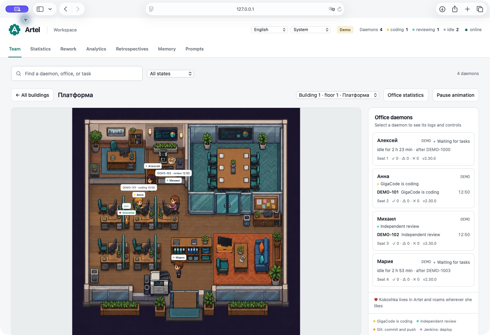

# Artel

**English** · [Русский](README.ru.md)

Local AI workers for your Jira workflow, with a dashboard to see and direct their work.

Artel runs on your own machine. Its workers—called **daemons**—pick up scoped Jira tasks,
implement them through GigaCode CLI, review the changes, and report back to Jira.
Each daemon serves a project or configuration item and can route work to several repositories.


*Demo installation with simulated workers and tasks. The office scene assets are included.*


*Open a floor to see the office, its residents, and their current work. Click an image to view it at full size.*

## What you can do

| Capability | How it works |
|---|---|
| Run a team | Start the dashboard and configured daemons together; organize workers into named offices and buildings. |
| Give workers different roles | Choose developer, tester, or custom profiles; set a subagent and instructions for seven workflow stages. |
| Follow execution | Watch GigaCode events and tool activity as they arrive, inspect results, and toggle daemon features. |
| Control the next attempt | Exclude tasks, pause retries, approve a repeat, or request rework after requirements change. |
| Improve between tasks | Revisit changed backlog stories, process Bitbucket PR feedback, run retrospectives, and verify memory candidates against code and tests. |
| Understand the workload | Filter task histories and analytics, browse records 20 at a time, and export task statistics as CSV. |

Jira and **Bitbucket Server / Data Center** use Python REST clients; these operations do not
depend on the model's MCP connections. Linked frontend tasks wait for configured backend
readiness. A `BLOCKED` result asks for clarification in Jira instead of repeatedly retrying.

<details>
<summary>More screenshots</summary>


*Statistics from simulated demo tasks; no production project data is shown.*


*Per-daemon roles, subagents, and instructions. Switch between English and Russian beside the appearance selector.*

</details>

## Quickstart

You need **Python 3.9+**, **Git**, and a separately installed **GigaCode CLI**. Artel itself
has no third-party Python runtime dependencies, Node.js requirement, or CDN dependency.
Give every daemon a separate working clone with an `origin` remote and access to its base branch.

1. Clone this repository and enter its directory:

   ```bash
   git clone https://github.com/Falikor/artel.git
   cd artel
   ```

2. Copy [the single-repository template](config/example.json.sample) to `config/team.json`.
   For multiple repositories, use [the services template](config/example-services.json.sample).
   Files ending in `.sample` are not launched.
3. Set `jira.url`, `jira.project`, `jira.status_analysis`, `jira.status_ready`, and
   `general.repo_path`. For a `main` base, set both `general.base_branch` and
   `general.base_branch_create_from` to `"main"`. Replace or remove the template's optional
   epic, configuration-item, and Jenkins settings.
4. Create `tmp/.env` with `JIRA_TOKEN=…`, or a project-prefixed token such as
   `TEAM_JIRA_TOKEN=…` when `jira.project` is `TEAM`. Add Bitbucket/Jenkins credentials only
   when enabling those integrations.
5. Install [the executor subagent](subagents/README.en.md) for the OS user running the daemons
   and set up OpenSpec in the working repositories. Set `general.require_success_marker: true`
   to require an explicit successful completion signal.
6. Validate the configuration, then start Artel if validation succeeds:

   ```bash
   python3 artel.py check
   python3 artel.py up
   ```

The [dashboard](http://127.0.0.1:8765/) opens automatically. Use `up --no-browser` to skip opening it.

**Windows:** in PowerShell, use `py -3 -X utf8 artel.py check`, followed by
`py -3 -X utf8 artel.py up`, or run `start-artel.cmd` after setup. Use JSON paths such as
`C:/work/service` and test commands appropriate for your OS. See [operations](docs/OPERATIONS.en.md).

**Office artwork:** the PNG/JSON scene assets are included in `office_dashboard/assets/`
with permission from the rights holder, so the animated office works after cloning.
To use another compatible pack, set `OFFICE_ASSETS` before starting Artel.

## Everyday operation

```bash
python3 artel.py status          # Show running processes
python3 artel.py restart team    # Reload config/team.json
python3 artel.py down            # Stop Artel; interrupts current work
```

Closing the browser does not stop the service. For updates that wait for current tasks,
use the [managed updater](UPDATE.en.md) with `--managed`: it backs up local data, waits for work,
updates code, and restarts the previous processes with their settings.

The dashboard binds to `127.0.0.1` and has no login. Anyone who can reach it can access logs
and controls; keep that in mind before exposing it beyond the local machine.

## Documentation

All guides below have English and Russian versions. Use the language links at the top of each guide.

| Topic | Guide |
|---|---|
| Stuck tasks, missed tasks, and paused workers | [Runbook](docs/RUNBOOK.en.md) |
| Configuration keys, defaults, environment variables, and services | [English reference](docs/CONFIGURATION.en.md) · [Русский](docs/CONFIGURATION.md) |
| Roles, subagents, and per-stage instructions | [Prompts](docs/PROMPTS.en.md) |
| Processes, Windows, logs, and backups | [Operations](docs/OPERATIONS.en.md) |
| Branches, dependencies, reviews, retries, and changed requirements | [Task lifecycle](docs/WORKFLOW.en.md) |
| Backlog research and pull request feedback | [Backlog](docs/BACKLOG.en.md) · [Bitbucket](docs/BITBUCKET.en.md) |
| Memory verification and retrospectives | [Memory](docs/MEMORY.en.md) |
| Screens, themes, offices, seating, and statistics | [Dashboard](docs/DASHBOARD.en.md) |
| Safe updates and release history | [Update and recovery](UPDATE.en.md) · [Changelog](CHANGELOG.en.md) |
| UI architecture and regression checks | [Dashboard architecture](office_dashboard/README.en.md) · [Tests](tests/README.en.md) |

The configuration reference includes complete developer, tester, and multi-service examples,
plus variations for review, task dependencies, Windows, TLS, model selection, and bounded memory.
It explains which values come from JSON, environment variables, and dashboard overrides.

## Local data

`config/` holds installation settings, `tmp/.env` holds secrets, `memory/` holds learned knowledge,
and `logs/` holds history and runtime state. Dashboard JSON files store names, characters,
prices, office/building names, and seating. These local files are excluded from Git.

The updater preserves this data. Do not replace a working installation by unpacking an archive
over the entire directory; include external data paths in backups with `--data-path`.
