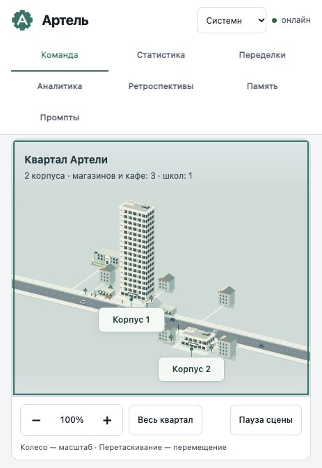
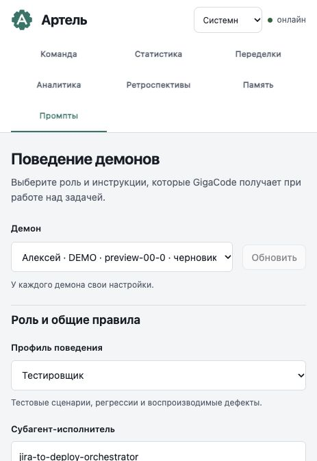

# Артель демонов

[English](README.md) · **Русский**

Артель — локальный сервис, который берёт задачи из Jira, реализует их через GigaCode CLI,
проверяет изменения и возвращает результат в Jira. Веб-дашборд показывает работу демонов,
живые логи, офисы, память, переделки и статистику.

Один демон обслуживает проект или КЭ; несколько репозиториев можно объединить в его конфиге
как сервисы. В простое он исследует бэклог, разбирает замечания к своим PR в Bitbucket
Server / Data Center и проверяет кандидатов памяти. Jira и Bitbucket вызываются через
Python REST-клиенты: доступность MCP у модели для этих операций не требуется.


*Демонстрационная установка с вымышленными демонами и задачами. Для офисной сцены ассеты устанавливаются отдельно.*

<details>
<summary>Другие экраны</summary>


*Статистика вымышленных задач демо; данные рабочих проектов не показаны.*


*Выбор профиля тестировщика для демо-демона. Интерфейс и справочники пока доступны на русском языке.*

</details>

## Быстрый старт

Нужны **Python 3.9+**, **Git** и отдельно установленный **GigaCode CLI**. Python-зависимостей,
Node.js и CDN для запуска нет. Каждый демон должен иметь отдельный рабочий клон с `origin`
и доступом к нужной базовой ветке.

1. Скопируйте [шаблон одного репозитория](config/example.json.sample) в `config/team.json`.
   Для нескольких репозиториев используйте [шаблон сервисов](config/example-services.json.sample).
   Файлы `.sample` не запускаются.
2. Укажите `jira.url`, `jira.project`, `jira.status_analysis`, `jira.status_ready`,
   `general.repo_path` и базовые ветки. Для `main` задайте
   `general.base_branch: "main"` и `general.base_branch_create_from: "main"`.
   Замените или уберите необязательные настройки эпика, КЭ и Jenkins из шаблона.
3. Создайте `tmp/.env` и задайте `JIRA_TOKEN=…` (или `TEAM_JIRA_TOKEN=…`, где `TEAM` —
   значение `jira.project`). Токены Bitbucket/Jenkins добавляются при включении этих интеграций.
4. Установите [субагента-исполнителя](subagents/README.md) для пользователя, запускающего демонов.
   Проверьте OpenSpec в рабочих репозиториях. Рекомендуется `general.require_success_marker: true`.
5. Из папки Артели проверьте конфиги и запустите сервис:

```bash
python3 artel.py check
python3 artel.py up
```

Продолжайте запуск, если проверка прошла. Откроется [дашборд](http://127.0.0.1:8765/).
Для работы без открытия браузера: `python3 artel.py up --no-browser`.

**Windows:** в PowerShell используйте `py -3 -X utf8 artel.py check`, затем
`py -3 -X utf8 artel.py up`; либо `start-artel.cmd` после настройки.
Пути в JSON удобно писать как `C:/work/service`. Команды тестов должны соответствовать ОС.
[Подробности запуска и ограничения Windows](docs/OPERATIONS.md).

**Офисная сцена:** лицензированные PNG/JSON-ассеты со скриншотов не включены в публичный
репозиторий. Установите совместимый пак, который имеете право использовать, в
`office_dashboard/assets/` или укажите внешний каталог через `OFFICE_ASSETS`.
[Структура пака и настройка](office_dashboard/assets/README.md).
Без ассетов полная анимированная офисная сцена недоступна.

## Ежедневная работа

| Действие | Где или как |
|---|---|
| Состояние всех демонов | `python3 artel.py status` |
| Текущие действия GigaCode | Дашборд → демон → **Логи GigaCode** |
| Включить Jira, PR, память, ревью | Демон → **Настройки → Функции демона** |
| Настроить роль тестировщика или свои инструкции | **Промпты** → выбрать демона |
| Исключить задачу или разрешить повтор | Демон → **Повторы** |
| Выполнить задачу по новой постановке | **Переделки → Направить демона на переделку** |
| Разобрать спорные уроки | **Память** |
| Перезапустить после правки конфига | `python3 artel.py restart team` (имя JSON без расширения) |
| Остановить Артель | `python3 artel.py down` или `stop-artel.cmd` |

`down` прерывает текущую работу; это не ожидание завершения задач. Для обновления с ожиданием
используйте [updater в режиме `--managed`](UPDATE.md). Закрытие браузера сервис не останавливает.
Дашборд слушает `127.0.0.1` и не требует входа; доступ к его адресу даёт доступ к логам и управлению.

## Документация

| Мне нужно | Документ |
|---|---|
| Задача зависла, демон не берёт задачу, снять паузу | [Runbook](docs/RUNBOOK.md) |
| Все ключи, значения по умолчанию, ENV и сервисы | [Справочник конфигурации](docs/CONFIGURATION.md) |
| Роли демонов, субагенты и инструкции этапов | [Промпты](docs/PROMPTS.md) |
| Процессы, Windows, запуск, логи и архив | [Эксплуатация](docs/OPERATIONS.md) |
| Ветки, ревью, зависимости, BLOCKED, ретраи и переделки | [Жизненный цикл задачи](docs/WORKFLOW.md) |
| Повторное исследование изменённых story | [Исследование бэклога](docs/BACKLOG.md) |
| Обработка замечаний и неопределённая отправка ответа | [Bitbucket](docs/BITBUCKET.md) |
| Ограничения памяти, автоматическая проверка и ретроспектива | [Память](docs/MEMORY.md) |
| Экраны, темы, город, рассадка и статистика | [Дашборд](docs/DASHBOARD.md) |
| Обновить миник, сохранить память и настройки | [Обновление и восстановление](UPDATE.md) |
| Что изменилось в выпусках | [CHANGELOG](CHANGELOG.md) |
| Устройство интерфейса и проверки кода | [Архитектура дашборда](office_dashboard/README.md), [тесты](tests/README.md) |

## Данные установки

`config/` — конфиги, `tmp/.env` — секреты, `memory/` — знания, `logs/` — история и состояние.
Имена, персонажи, цены, рассадка, названия офисов и корпусов хранятся в JSON-файлах
`office_dashboard/`. Эти данные сохраняются штатным updater; не заменяйте рабочую папку
распакованным архивом целиком. Внешние пути данных включайте в резервную копию через `--data-path`.

Ассеты LennoxStudio и AI Artel разрешены для использования в продукте, но не для отдельного
распространения. Сохраняйте исходные условия лицензий ассетов при переносе проекта.
